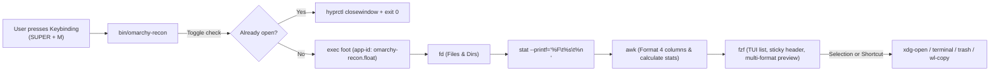

# AGENT.md: AI Agent Extension & Customization Guide

This document is specifically written for AI coding assistants (Antigravity, Cursor, Claude Code, Codex, Copilot) and developers modifying `omarchy-recon`.

When a user asks:
- *"Add a custom previewer for 3D models or audio files"*
- *"Add another action keybinding (e.g. Git status on folder)"*
- *"Adjust the search exclusions or category filters"*
- *"Modify the floating window dimensions or behavior"*

Follow the architectural maps and recipes below. Make surgical, minimal edits without adding heavy runtime dependencies.

---

## 1. Architectural Map

```text
omarchy-recon/
├── bin/
│   └── omarchy-recon          # Core script: argument parser, toggle logic, AWK parser, fzf TUI
├── config/
│   └── recon.conf.example     # Default user configuration template (~/.config/omarchy/recon.conf)
├── hypr/
│   └── recon.lua              # Hyprland window rule (class: omarchy-recon.float) and keybinding
├── install.sh                 # Symlinks bin/ to ~/.local/bin/ and provisions config
├── README.md                  # Human-facing user manual
└── AGENT.md                   # This instruction file for AI agents
```

---

## 2. Execution Pipeline

Understanding the data flow is essential before editing:



---

## 3. Variable & Configuration Dictionary

| Variable | File Location | Default | Purpose & Acceptable Values |
| :--- | :--- | :--- | :--- |
| `TARGET_DIR` | `bin/omarchy-recon`, `recon.conf` | `$HOME` | Root directory indexed. Overridden by CLI argument `$1`. |
| `EXCLUDE_DIRS` | `bin/omarchy-recon`, `recon.conf` | `"DOTFILES BRAIN ..."` | Space-separated list of folder names excluded by `fd`. |
| `INCLUDE_HIDDEN`| `bin/omarchy-recon`, `recon.conf`| `"false"` | `"false"` = skips `.*` dotfiles/dotfolders. `"true"` = indexes hidden files (`fd -H`). |
| `INCLUDE_DIRS` | `bin/omarchy-recon`, `recon.conf`| `"true"` | `"true"` = indexes directories as `[DIR]`. `"false"` = files only. |
| `PREVIEW_LAYOUT`| `bin/omarchy-recon`, `recon.conf`| `"down:50%:wrap"`| Layout in `fzf`. Options: `"down:50%:wrap"`, `"right:50%:wrap"`, `"hidden"`. |
| `APP_ID` | `bin/omarchy-recon`, `recon.lua` | `"omarchy-recon.float"` | Wayland window class used by Hyprland window rules and toggle checks. |
| `WINDOW_WIDTH` | `hypr/recon.lua` | `1350` | Floating window width in pixels. Must fit 4 columns + preview. |
| `WINDOW_HEIGHT`| `hypr/recon.lua` | `780` | Floating window height in pixels. |

---

## 4. Customization Recipes for Agents

### Recipe A: Adding or Changing File Type Tags
**File to touch**: [`bin/omarchy-recon`](bin/omarchy-recon) (inside the inner `awk` script).

**How it works**:
In the `awk` block, extensions are matched and assigned a bracketed `tag`, and a counter is incremented for the stats header:

```awk
# Example: Adding Audio/Music category
else if (ext ~ /^(mp3|flac|wav|ogg|m4a)$/) { tag = "[AUDIO]"; c_audio++ }
```

Don't forget to include the counter in the `END` block of `awk`:
```awk
END {
  printf "📊 %s: %d Items (... │ AUDIO: %d)\t\n", lbl, n, ..., c_audio
}
```

And add an `alt-...` keybinding in `fzf`:
```bash
--bind="alt-m:change-query([AUDIO] )"
```

---

### Recipe B: Modifying the Preview Pipeline
**File to touch**: [`bin/omarchy-recon`](bin/omarchy-recon) (the `--preview` option in `fzf`).

**Current implementation**:
- Directories: `eza --tree --level=2 --color=always` ➔ `tree -L 2` ➔ `ls -lhA`
- Images: `chafa -s 80x25 "$f"` ➔ `file -b "$f"`
- PDFs: `pdftotext -l 10 "$f" -`
- Code/Text: `bat --style=numbers --color=always "$f"` ➔ `cat "$f"`

**Example: Adding Audio Metadata Preview via `mediainfo` or `ffprobe`**:
```bash
elif [[ "$f" =~ \.(mp3|flac|wav|ogg|m4a)$ ]]; then
  mediainfo "$f" 2>/dev/null || ffprobe -hide_banner "$f" 2>&1
```

---

### Recipe C: Adding New Keybindings & Actions in FZF
**File to touch**: [`bin/omarchy-recon`](bin/omarchy-recon) (the `--bind` arguments in `fzf`).

`{2}` represents the raw unescaped file path.

| User Request | Action to Add |
| :--- | :--- |
| **Open in VSCode** | `--bind="ctrl-v:execute-silent(code {2})+abort"` |
| **Open in Sublime Text**| `--bind="ctrl-s:execute-silent(subl {2})+abort"` |
| **Run Executable Script**| `--bind="ctrl-r:execute({2})+abort"` |
| **Git Status on Folder** | `--bind="ctrl-g:execute(d={2}; [[ -f \"\$d\" ]] && d=\$(dirname \"\$d\"); git -C \"\$d\" status)+abort"` |

Also update `HEADER="..."` in `bin/omarchy-recon` to reflect new shortcuts.

---

## 5. Verification Protocol for Agents

Whenever making changes, an AI agent **must run these commands before reporting completion**:

1. **Syntax Check**:
   ```bash
   bash -n bin/omarchy-recon
   ```
2. **Dry-Run Data Generation Check**:
   ```bash
   bin/omarchy-recon --help
   ```
3. **Hyprland Rules Check**:
   ```bash
   hyprctl reload
   ```
