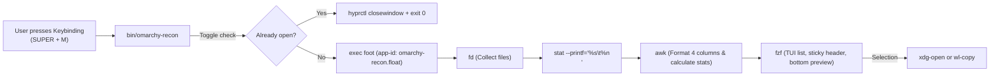

# AGENT.md: AI Agent Extension & Customization Guide

This document is specifically written for AI coding assistants (Antigravity, Cursor, Claude Code, Codex, Copilot) and developers modifying `omarchy-recon`.

When a user asks:
- *"Add image preview support to recon"*
- *"Add a new file category for video/audio"*
- *"Change the default window size or keybinding"*
- *"Add a custom action to open files in Neovim"*

Follow the architectural maps and recipes below. Make surgical, minimal edits without adding heavy runtime dependencies.

---

## 1. Architectural Map

```text
omarchy-recon/
├── bin/
│   └── omarchy-recon          # Core script: argument parser, toggle logic, AWK parser, fzf TUI
├── config/
│   └── recon.conf.example     # Default user configuration template (~/.config/omarchy/recon.conf)
├── hypr/
│   └── recon.lua              # Hyprland window rule (class: omarchy-recon.float) and keybinding
├── install.sh                 # Symlinks bin/ to ~/.local/bin/ and provisions config
├── README.md                  # Human-facing user manual
└── AGENT.md                   # This instruction file for AI agents
```

---

## 2. Execution Pipeline

Understanding the data flow is essential before editing:



---

## 3. Variable & Configuration Dictionary

| Variable | File Location | Default | Purpose & Acceptable Values |
| :--- | :--- | :--- | :--- |
| `TARGET_DIR` | `bin/omarchy-recon`, `recon.conf` | `$HOME` | Root directory indexed. Overridden by CLI argument `$1`. |
| `EXCLUDE_DIRS` | `bin/omarchy-recon`, `recon.conf` | `"DOTFILES BRAIN ..."` | Space-separated list of folder names excluded by `fd`. |
| `INCLUDE_HIDDEN`| `bin/omarchy-recon`, `recon.conf`| `"false"` | `"false"` = skips `.*` dotfiles/dotfolders. `"true"` = indexes hidden files (`fd -H`). |
| `PREVIEW_LAYOUT`| `bin/omarchy-recon`, `recon.conf`| `"down:50%:wrap"`| Layout in `fzf`. Options: `"down:50%:wrap"`, `"right:50%:wrap"`, `"hidden"`. |
| `APP_ID` | `bin/omarchy-recon`, `recon.lua` | `"omarchy-recon.float"` | Wayland window class used by Hyprland window rules and toggle checks. |
| `WINDOW_WIDTH` | `hypr/recon.lua` | `1350` | Floating window width in pixels. Must fit 4 columns + preview. |
| `WINDOW_HEIGHT`| `hypr/recon.lua` | `780` | Floating window height in pixels. |

---

## 4. Customization Recipes for Agents

### Recipe A: Adding or Changing File Type Tags
**File to touch**: [`bin/omarchy-recon`](bin/omarchy-recon) (inside the inner `awk` script).

**How it works**:
In the `awk` block, extensions are matched and assigned a bracketed `tag`, and a counter is incremented for the stats header:

```awk
# Example: Adding Media/Video category
else if (ext ~ /^(mp4|mkv|mov|avi|mp3|flac|wav)$/) { tag = "[MEDIA]"; c_media++ }
```

Don't forget to include the counter in the `END` block of `awk`:
```awk
END {
  printf "📊 %s: %d Files (... │ MEDIA: %d)\t\n", lbl, n, ..., c_media
}
```

---

### Recipe B: Modifying the Previewer (e.g. Images or Custom Viewers)
**File to touch**: [`bin/omarchy-recon`](bin/omarchy-recon) (the `--preview` option in `fzf`).

**Current implementation**:
```bash
--preview='f={2}; if [[ "$f" =~ \.(pdf|PDF)$ ]]; then pdftotext -l 10 "$f" - 2>/dev/null || echo "[PDF Text Unavailable]"; else bat --style=numbers --color=always "$f" 2>/dev/null || cat "$f" 2>/dev/null; fi'
```

**Adding image previews via `chafa` (terminal graphics)**:
```bash
--preview='f={2}; \
  if [[ "$f" =~ \.(png|jpg|jpeg|webp|gif)$ ]]; then chafa -s 60x25 "$f" 2>/dev/null; \
  elif [[ "$f" =~ \.(pdf|PDF)$ ]]; then pdftotext -l 10 "$f" - 2>/dev/null; \
  else bat --style=numbers --color=always "$f" 2>/dev/null || cat "$f" 2>/dev/null; fi'
```

---

### Recipe C: Adding New Keybindings & Actions in FZF
**File to touch**: [`bin/omarchy-recon`](bin/omarchy-recon) (the `--bind` arguments in `fzf`).

`{2}` represents the raw unescaped file path.

| User Request | Action to Add |
| :--- | :--- |
| **Open in Neovim** | `--bind="ctrl-e:execute(nvim {2})+abort"` |
| **Open Containing Folder** | `--bind="ctrl-o:execute-silent(xdg-open $(dirname {2}))+abort"` |
| **Delete File (with confirm)** | `--bind="ctrl-d:execute(rm -i {2})+reload(...)"` |

Also update `HEADER="..."` in `bin/omarchy-recon` to show the new shortcut to the user.

---

### Recipe D: Adjusting Column Widths
**File to touch**: [`bin/omarchy-recon`](bin/omarchy-recon) (lines 142-154 in `awk`).

- Column 1: `tag` (Width: `%-8s`)
- Column 2: `disp_name` (Width: `%-40s`, truncated if > 40 chars)
- Column 3: `dir` (Width: `%-35s`, truncated if > 35 chars)
- Column 4: `size` (Width: `%7s`, e.g. `114.0K`, `3.2M`)

When changing widths, ensure both the header format string and data row format string match exactly:
```awk
# Header
printf "%-8s  %-40s  %-35s  %7s\t\n", "TYPE", "FILE", "FOLDER", "SIZE"
# Row
lines[++n] = sprintf("%-8s  %-40s  %-35s  %7s\t%s", tag, disp_name, dir, fmt_size(bytes), full)
```

---

## 5. Verification Protocol for Agents

Whenever making changes, an AI agent **must run these commands before reporting completion**:

1. **Syntax Check**:
   ```bash
   bash -n bin/omarchy-recon
   ```
2. **Dry-Run Data Generation Check**:
   Test that `fd`, `stat`, and `awk` produce clean tabular output without errors:
   ```bash
   bin/omarchy-recon --help
   ```
3. **Hyprland Rules Check**:
   ```bash
   hyprctl reload
   ```
