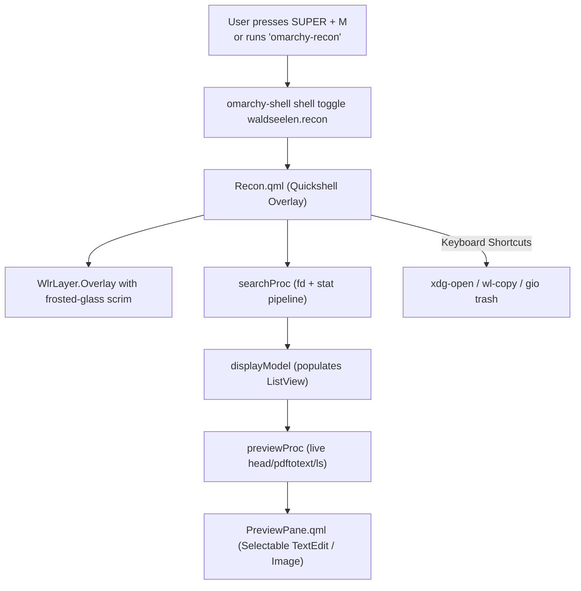

# AGENT.md: AI Agent Extension & Customization Guide

This document is specifically written for AI coding assistants (Antigravity, Cursor, Claude Code, Codex, Copilot) and developers modifying `omarchy-recon`.

When a user asks:
- *"Add a custom previewer for 3D models or audio files"*
- *"Add another action keybinding (e.g. Open in Neovim, Git status)"*
- *"Adjust the search exclusions or category filter tabs"*
- *"Modify the frosted-glass overlay window dimensions or theme tokens"*

Follow the architectural maps and recipes below.

---

## 1. Architectural Map

`omarchy-recon` is a native **Omarchy Quickshell QML Overlay Plugin** (`waldseelen.recon`):

```text
omarchy-recon/
├── manifest.json              # Plugin contract (id: waldseelen.recon, kind: overlay)
├── Recon.qml                  # Main entry point (PanelWindow, BorderSurface, Process engine, keyCatcher)
├── ReconHeader.qml            # Search input display & status badge
├── ReconTabs.qml              # Category filter chips (All, Folders, Docs, Code, PDF, Office, Images)
├── ResultRow.qml              # Ergonomic 2-line list row delegate ([TAG], Name, Folder, Size)
├── PreviewPane.qml            # Split preview pane with selectable TextEdit, Image preview, folder list
├── script/
│   └── Core.js                # Shared JS helpers (formatBytes, getTag, collapsePath, matchesTab)
├── bin/
│   └── omarchy-recon          # CLI wrapper forwarding calls to `omarchy-shell shell toggle waldseelen.recon`
├── hypr/
│   └── recon.lua              # Hyprland bindings template
├── README.md                  # Human-facing user manual
└── AGENT.md                   # This instruction file for AI agents
```

---

## 2. Execution Pipeline



---

## 3. Key Files & Responsibilities

| File | Purpose | How to Modify |
| :--- | :--- | :--- |
| `manifest.json` | Omarchy plugin manifest schema | Update version, plugin ID, or entry points. Must pass `omarchy plugin validate .` |
| `Recon.qml` | Top-level Quickshell overlay, key event loop, process orchestration | Change window size (`cardWidth`, `cardHeight`), key bindings in `keyCatcher`, or background commands |
| `ReconTabs.qml` | Category filter chips | Add new tabs to `tabsRoot.tabs` array |
| `ResultRow.qml` | ListView row delegate | Modify column widths, font sizes, colors, or tag badge styles |
| `PreviewPane.qml` | Split interactive preview | Customize `TextEdit` selection styling, add media player, or change headers |
| `script/Core.js` | Business logic & formatting | Add file extensions to `getTag()`, update path collapsing |
| `bin/omarchy-recon` | Terminal CLI launcher | Accepts optional directory argument and passes to `omarchy-shell` |

---

## 4. Customization Recipes for Agents

### Recipe A: Adding a New Category Filter Chip
1. In [`script/Core.js`](script/Core.js):
   - Add new file extensions to `getTag(path, isDir)`:
     ```js
     if (/^(mp3|flac|wav|ogg|m4a)$/.test(ext)) return "AUDIO";
     ```
   - Update `matchesTab(tag, tab)`:
     ```js
     if (tab === "audio") return tag === "AUDIO";
     ```
2. In [`ReconTabs.qml`](ReconTabs.qml):
   - Add the chip to `readonly property var tabs`:
     ```qml
     { id: "audio", label: "Audio" }
     ```
3. In [`Recon.qml`](Recon.qml):
   - Add `audio` to `cycleTab`:
     ```js
     var tabs = ["all", "folders", "docs", "code", "pdf", "office", "images", "audio"]
     ```
   - Add fd filter flags inside `executeSearch()`:
     ```js
     else if (tab === "audio") typeFlags = "-t f -e mp3 -e flac -e wav -e ogg"
     ```

---

### Recipe B: Changing Target Exclusions or Default Drive
In [`Recon.qml`](Recon.qml):
- Default target directory: `property string targetDir: "/run/media/hp/SSS"`
- Excluded directories in `executeSearch()`:
  ```js
  fd -i --exclude DOTFILES --exclude BRAIN --exclude KUBUNTU --exclude WIN --exclude MEDIA --exclude '.Trash*' ...
  ```
Add any new folder to `--exclude <NAME>`.

---

### Recipe C: Adding a Custom Keyboard Action
In [`Recon.qml`](Recon.qml) inside `keyCatcher.Keys.onPressed`:
```qml
} else if ((event.key === Qt.Key_E) && (event.modifiers & Qt.ControlModifier)) {
  // Ctrl+E: Edit in Neovim terminal
  var item = displayModel.get(root.selectedIndex)
  if (item && item.path) {
    Util.execDetached("foot -e nvim " + Util.shellQuote(item.path))
  }
  root.dismiss()
  event.accepted = true
```

---

## 5. Verification Commands

Always run these after modifying code:
```bash
# 1. Validate manifest
omarchy plugin validate /home/hp/Work/omarchy-recon

# 2. Rescan and reload shell
omarchy-shell shell rescanPlugins
omarchy restart shell

# 3. Test toggle
omarchy-shell shell toggle waldseelen.recon
```
